## Abstract

This study examines how crime rates and population density relate to support for Donald Trump across Oregon's 36 counties in the 2024 election. I hypothesize that higher crime rates are associated with lower Trump support, but that population density shapes this relationship. Crime records, Census population data, county election returns, and per-capita income were merged and analyzed in R. I estimate three regressions: logged crime rate alone; logged crime rate and logged population density; and a model adding a crime × density interaction and per-capita income.

In the simple model, higher crime is significantly associated with lower Trump support. Once density is added, the crime effect shrinks and becomes insignificant, while density is a strong negative predictor. The interaction suggests that crime's association with Trump support depends on density. The apparent crime effect is largely an urban-density effect. Limitations include crime-reporting measurement error and the single-state focus.

## 1. Introduction

Scholars disagree about how crime, urban structure, and political behavior interact. One view holds that higher crime raises demand for tough-on-crime policies, a stance often associated with conservative candidates (Becker 1968; Levitt 1997). Another holds that high-crime urban areas may support conservative candidates less, because of broader socioeconomic conditions and urban social organization (Sampson, Raudenbush, and Earls 1997).

This study asks: **How do crime rates and population density relate to Trump support in Oregon counties?**

- **H1:** Higher crime rates (logged crimes per capita) are associated with lower Trump support when considered alone.
- **H2:** Population density confounds this relationship: once density is controlled for, the crime association weakens, and lower-density counties show higher Trump support.
- **H3:** When per-capita income is controlled for, crime and density remain relevant predictors, and income may add explanatory power.

Glaeser and Sacerdote (1999) and Sampson et al. (1997) suggest social disorganization and resource scarcity shape both crime and political preferences, while Becker's (1968) economic model of crime implies that perceived safety and enforcement affect electoral choices. Combining these perspectives, the study tests whether Oregon data support the idea that crime and urban structure shape political outcomes.

## 2. Data and methodology

**Crime.** Total offenses, including crimes against persons, property, and society, from the FBI's National Incident-Based Reporting System (2023). Agency-level incident totals were aggregated to counties.

**Election.** County Trump vote counts from the Oregon Secretary of State's official 2024 results.

**Population and income.** Population (POP20) and population density (POPDENS20) from the 2020 Census; per-capita income from the Bureau of Labor Statistics.

**Processing in R.** Data were read with `readxl` and cleaned with `dplyr` and `tidyr`: renaming columns, removing extraneous rows, standardizing county names, merging on county, and aggregating crime by county. I computed:

- `crime_per_capita`: total crimes ÷ population × 100,000
- `trump_proportion`: Trump votes ÷ total population × 100, that is, **Trump votes per 100 residents**. This is a turnout-dependent measure, not the share of votes cast.

Because crime and density are right-skewed, both were log-transformed. Three OLS models were estimated:

1. Trump votes per 100 residents on logged crime rate
2. Adding logged population density
3. Adding a crime × density interaction and per-capita income

Scatterplots, histograms, and interaction plots were produced with `ggplot2`; regression tables with `stargazer`.

**Table 1. Summary statistics (logged variables)**

| | Trump votes per 100 residents | log crime per capita | log population density | Income ($) |
| --- | --- | --- | --- | --- |
| Min. | 8.68 | 0.00 | −0.30 | 40,360 |
| 1st Qu. | 25.04 | 7.71 | 1.77 | 53,415 |
| Median | 29.76 | 8.30 | 3.21 | 58,475 |
| Mean | 31.21 | 7.76 | 3.11 | 59,653 |
| 3rd Qu. | 38.55 | 8.59 | 4.38 | 61,956 |
| Max. | 48.56 | 9.78 | 7.55 | 81,025 |

**Table 2. Summary statistics (original scale)**

| | Crime per 100k | Population density (per sq. mi.) |
| --- | --- | --- |
| Min. | 0 | 0.74 |
| Median | 4,026 | 24.90 |
| Mean | 4,155 | 120.77 |
| Max. | 17,754 | 1,891.24 |

## 3. Results

Trump votes per 100 residents vary widely across counties (mean 31.2). Crime and density are right-skewed, which justifies the log transformations.

**Table 3. OLS regressions of Trump votes per 100 residents (N = 36 counties)**

| | (1) | (2) | (3) |
| --- | --- | --- | --- |
| log crime per capita | −2.753*** (0.883) | −0.461 (0.708) | −0.208 (0.699) |
| log population density | | −3.985*** (0.636) | 5.373 (4.794) |
| Per-capita income | | | 0.0001 (0.0001) |
| log crime × log density | | | −1.120* (0.561) |
| Constant | 52.583*** (7.020) | 47.199*** (4.891) | 41.882*** (8.262) |
| R² | 0.222 | 0.645 | 0.686 |
| Adjusted R² | 0.199 | 0.623 | 0.646 |
| Residual std. error | 9.072 (df = 34) | 6.222 (df = 33) | 6.033 (df = 31) |
| F statistic | 9.716*** | 29.965*** | 16.959*** |

*Standard errors in parentheses. \*p < 0.1; \*\*p < 0.05; \*\*\*p < 0.01.*

**Model 1.** Logged crime has a coefficient of −2.75 (p = 0.004). Alone, higher crime is associated with lower Trump support.

**Model 2.** Adding logged density shrinks the crime coefficient to −0.46 (p = 0.519), while density is a strong predictor (−3.99, p = 4.41 × 10⁻⁷). Urban context, not crime, carries the association. R² rises from 0.22 to 0.65.

**Model 3.** The crime × density interaction is −1.12, marginally significant with conventional standard errors (p ≈ 0.055) and significant with heteroskedasticity-robust standard errors (p = 0.004). The association between crime and Trump support becomes more negative as density rises. Income is not significant. R² is 0.69. Diagnostic plots (Q-Q plots, Cook's distance) did not indicate serious assumption violations.

### Figures

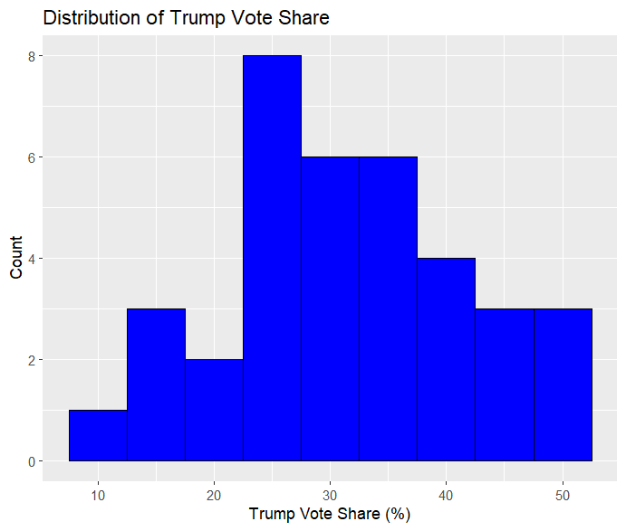

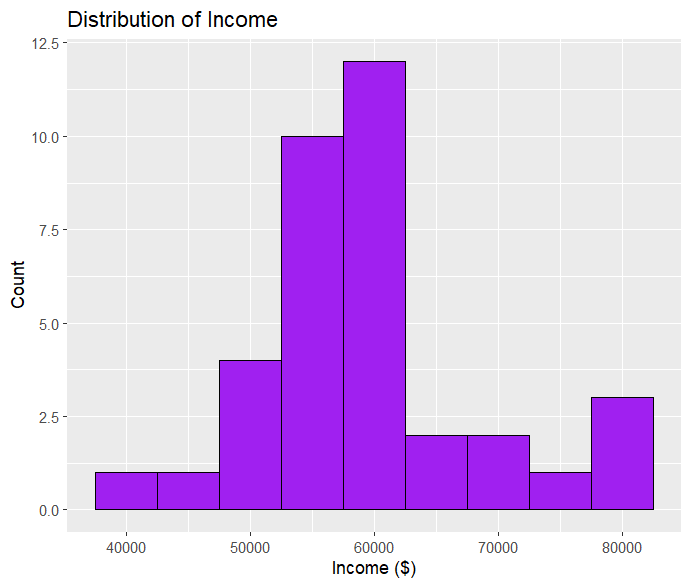

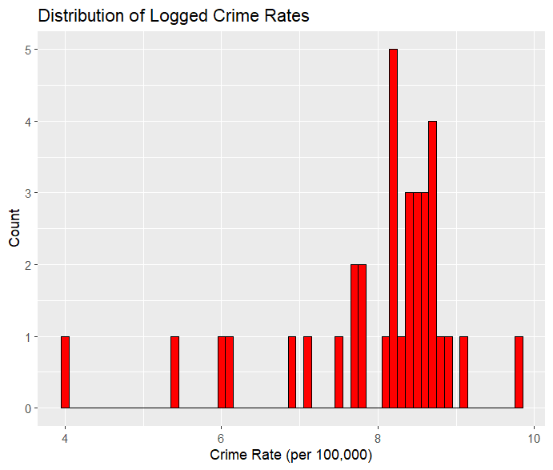

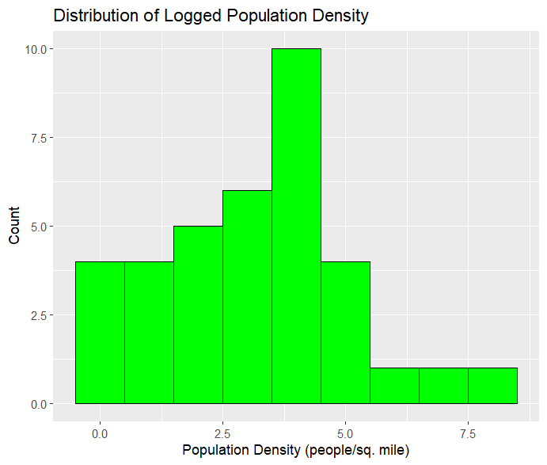

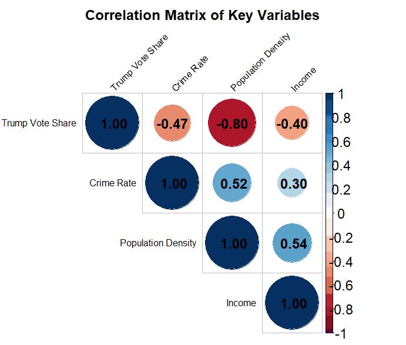

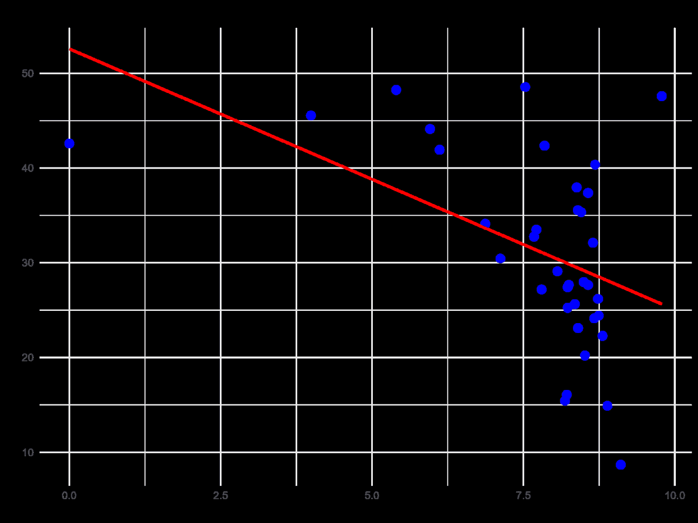

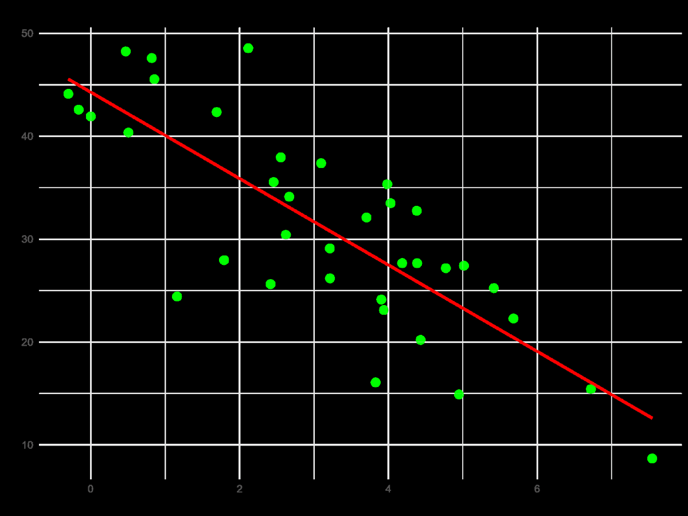

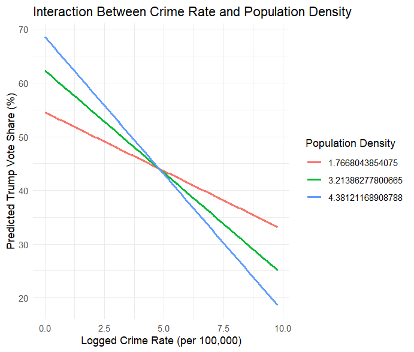

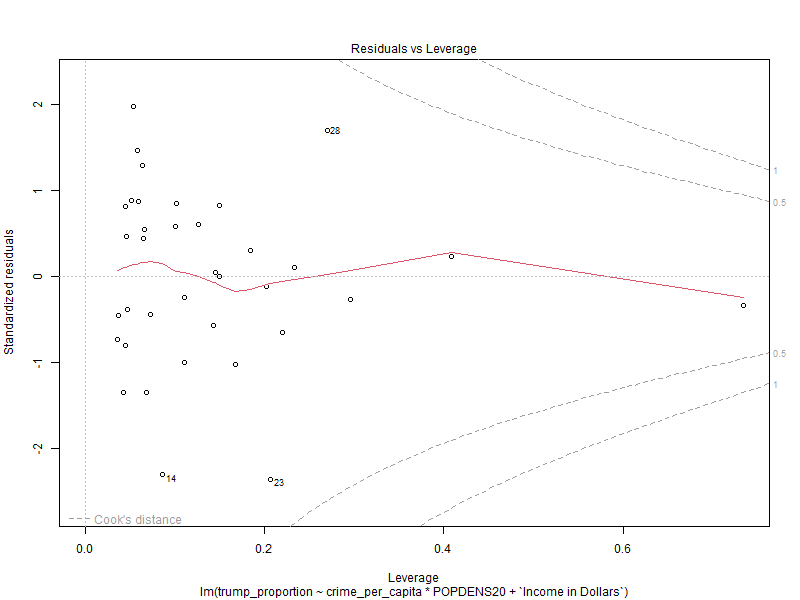

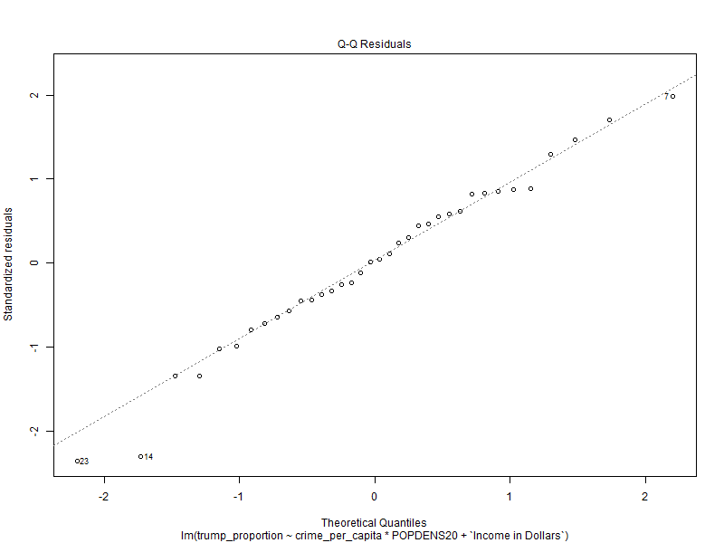

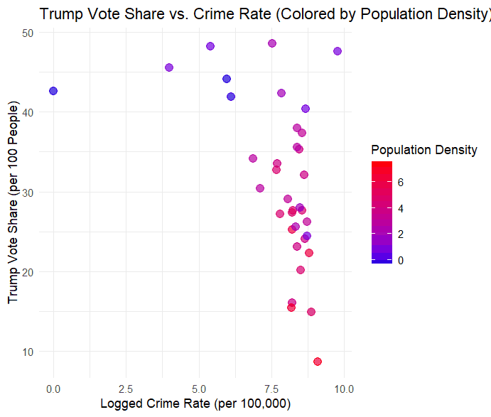

(Figures 1 and 2 in the original are the summary tables above.)

## 4. Discussion

The findings complicate the expectation that high-crime areas favor tough-on-crime candidates. Alone, crime is negatively associated with Trump support, but most of that association reflects population density: denser, more urban counties have both more reported crime and less Trump support, consistent with prior work on urban political behavior (Glaeser and Sacerdote 1999; Sampson et al. 1997).

The interaction suggests the crime–vote relationship differs between rural and urban counties. In low-density counties the negative association is weaker. Rural residents may perceive or experience crime differently, while in denser areas crime reporting and political priorities move together.

Per-capita income did not predict Trump support once crime and density were included. In Oregon, urban structure appears more important than average income.

**Limitations.** The analysis uses one state and one election, 36 observations, and cross-sectional data, so it supports association, not causation. Crime reporting varies by agency. The outcome is Trump votes per resident rather than share of votes cast, so it also reflects turnout differences. Education, campaign activity, and past voting patterns are not controlled for. Future work should extend to multiple states, use vote share as the outcome, and test whether year-to-year changes in crime predict changes in vote choice.

## 5. Conclusion

In Oregon counties, higher crime rates alone are associated with lower Trump support, but this relationship is largely explained by population density, and the interaction suggests crime's association with voting depends on urban context. Crime statistics need to be read alongside the demographic setting in which they occur.

## References

Becker, G. S. (1968). Crime and punishment: An economic approach. *Journal of Political Economy*, 76(2), 169–217. https://doi.org/10.1086/259394

Enns, P. K. (2016). *Incarceration nation: How the United States became the most punitive democracy in the world.* Cambridge University Press.

Fajnzylber, P., Lederman, D., & Loayza, N. (2002). Inequality and violent crime. *Journal of Law and Economics*, 45(1), 1–40. https://doi.org/10.1086/338347

Glaeser, E. L., & Sacerdote, B. (1999). Why is there more crime in cities? *Journal of Political Economy*, 107(S6), S225–S258. https://doi.org/10.1086/250109

Krivo, L. J., & Peterson, R. D. (1996). Extremely disadvantaged neighborhoods and urban crime. *Social Forces*, 75(2), 619–650. https://doi.org/10.2307/2580416

Levitt, S. D. (1997). Using electoral cycles in police hiring to estimate the effect of police on crime. *American Economic Review*, 87(3), 270–290.

Sampson, R. J., Raudenbush, S. W., & Earls, F. (1997). Neighborhoods and violent crime: A multilevel study of collective efficacy. *Science*, 277(5328), 918–924. https://doi.org/10.1126/science.277.5328.918

**Data**

Bureau of Labor Statistics. (2023). Per capita income data. https://www.bls.gov/data/

Federal Bureau of Investigation. (2023). National Incident-Based Reporting System data. https://www.fbi.gov/services/cjis/ucr

Oregon Secretary of State. (2024). Official election results. https://sos.oregon.gov/elections

U.S. Census Bureau. (2020). County population and density. https://www.census.gov

---

*Editing note (2026): relabeled the outcome as "Trump votes per 100 residents" to match how it was computed, reworded H2 for clarity, corrected the citation details for Levitt (1997) and Glaeser & Sacerdote (1999), replaced an unverifiable Fajnzylber et al. (1998) entry with their 2002 article, and added the missing reference for Sampson et al. (1997). The original figures are restored from the submitted paper (the recovered county inputs now also support regeneration of the analyses). The coefficients reproduce the submitted table. The ordinary p-values for Model 2 have been corrected against the refitted models.*
